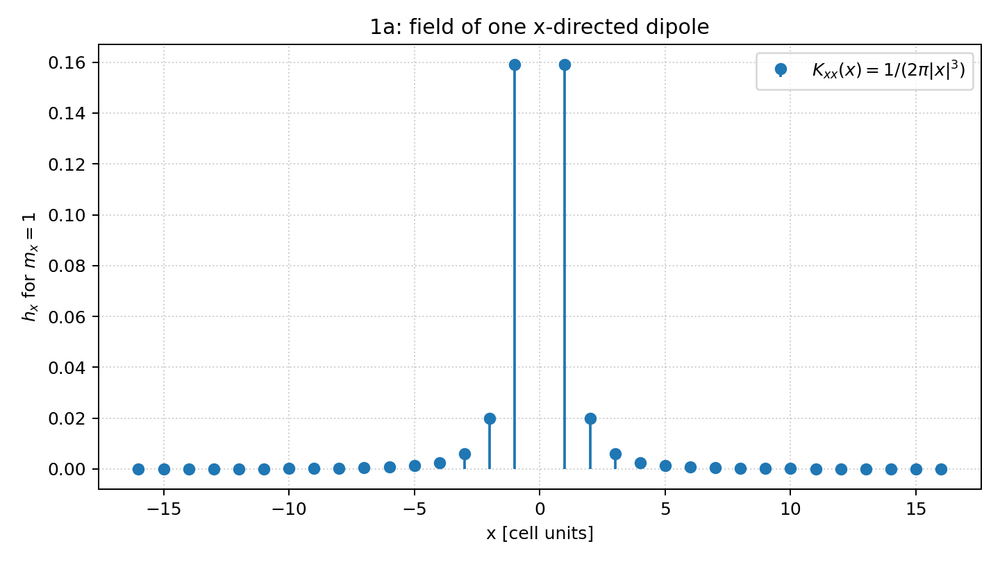
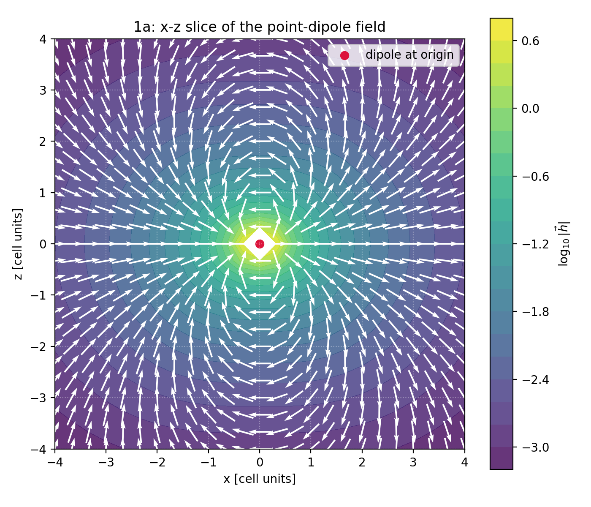
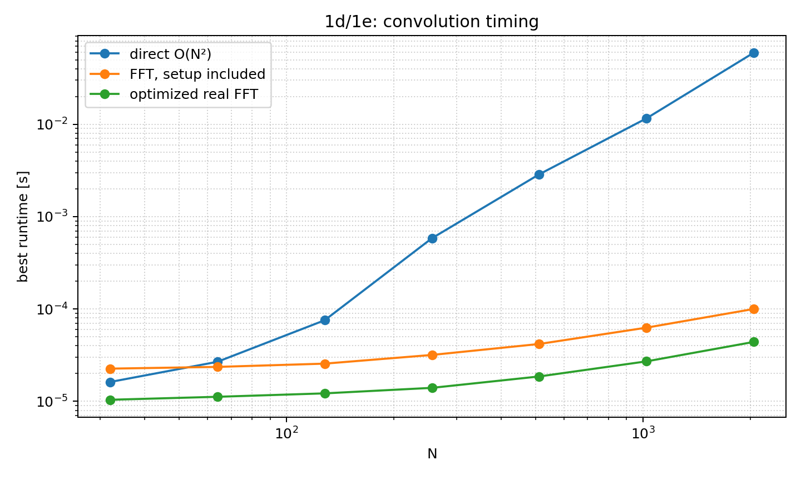
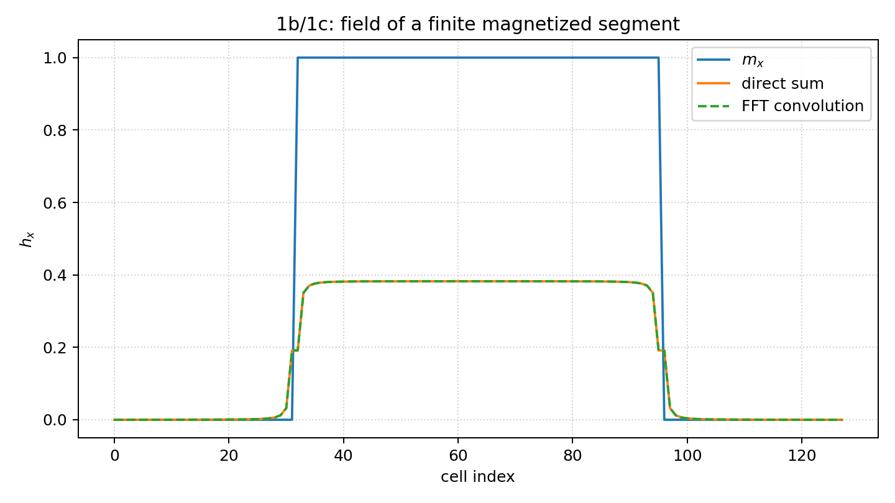

# Exercise 2 - Task 1: Demagnetizing field in 1D via FFT convolution

All cells have unit spacing. The point-dipole field is
$\vec h(\vec r)=\frac{1}{4\pi r^3}\left(3(\vec m\cdot\hat r)\hat r-\vec m\right)$.
For `m = m_x e_x` and `r = x e_x`, this gives
$h_x(x)=K_{xx}(x)m_x=\frac{m_x}{2\pi |x|^3}$ for $x\ne0$.

## 1a - Single dipole and self-interaction

On the x-axis the field is positive and even: it points in the +x direction on both sides of an x-directed dipole, and its magnitude decays as |x|^-3. The point-dipole model is singular at x=0. In this implementation the self term is excluded, `K_xx(0)=0`, so a cell does not act on itself. A nonzero finite-cell self-demagnetizing factor would require replacing the point kernel by a volume-averaged cell kernel.

The vector field itself is shown below in the x-z plane. Arrow directions are normalized for visibility; the color encodes the logarithm of the field magnitude. The point at the origin is omitted from the formula because the point-dipole field is singular there.

## 1b - Direct summation

$h_i=\sum_{j\ne i}\frac{m_j}{2\pi |i-j|^3}$ is evaluated directly.
At the segment ends the field is smaller than in the middle because one side has no magnetized source cells. Near the middle, contributions from both sides add and the field is approximately symmetric and nearly constant away from the ends. The exact values still show edge effects because the kernel is long-ranged.

## 1c - Linear convolution with the FFT

The convolution theorem is $\hat h_k=\hat K_k\hat m_k$.
A DFT computes a circular convolution. To obtain the desired linear convolution, both arrays are embedded in arrays of length L >= 2N-1 and padded with zeros. The kernel is arranged by displacement: `K[0]=0`, `K[d]=1/(2*pi*d^3)` for d=1,...,N-1, and `K[L-d]=K[d]`. This places positive and negative displacements at their wrapped FFT indices and prevents wrap-around terms from entering the first N output cells.

## 1d - Direct versus FFT scaling

The direct algorithm uses O(N²) pair interactions. The FFT method uses O(L log L) operations with L approximately 2N. Therefore FFT convolution becomes increasingly faster as N grows. N does not need to be a power of two: NumPy supports arbitrary lengths, although lengths with small prime factors are usually faster. The implementation selects a 2/3/5-smooth length at least 2N-1.

| N | FFT length | direct [s] | FFT [s] | optimized FFT [s] | max direct-FFT error | max direct-optimized error |
|---:|---:|---:|---:|---:|---:|---:|
| 32 | 64 | 1.440e-05 | 2.030e-05 | 1.060e-05 | 1.665e-16 | 1.665e-16 |
| 64 | 128 | 2.690e-05 | 2.330e-05 | 1.110e-05 | 2.220e-16 | 2.220e-16 |
| 128 | 256 | 7.490e-05 | 2.480e-05 | 1.190e-05 | 3.331e-16 | 3.331e-16 |
| 256 | 512 | 6.009e-04 | 3.160e-05 | 1.430e-05 | 3.331e-16 | 3.331e-16 |
| 512 | 1024 | 2.774e-03 | 4.090e-05 | 1.850e-05 | 2.776e-16 | 2.776e-16 |
| 1024 | 2048 | 1.166e-02 | 6.070e-05 | 2.690e-05 | 4.441e-16 | 4.441e-16 |
| 2048 | 4096 | 6.159e-02 | 2.279e-04 | 8.690e-05 | 5.551e-16 | 5.551e-16 |

## 1e - FFT optimization

The optimized version uses real-input transforms (`rfft`/`irfft`), computes the symmetric kernel spectrum only once, reuses the spectrum for repeated magnetization arrays, and chooses a smooth FFT length. These changes reduce memory and avoid redundant work while preserving the linear-convolution result. For repeated evaluations with the same N, kernel-spectrum reuse is the most important algorithmic optimization; FFT planning would be an additional optimization in libraries that expose reusable plans.

