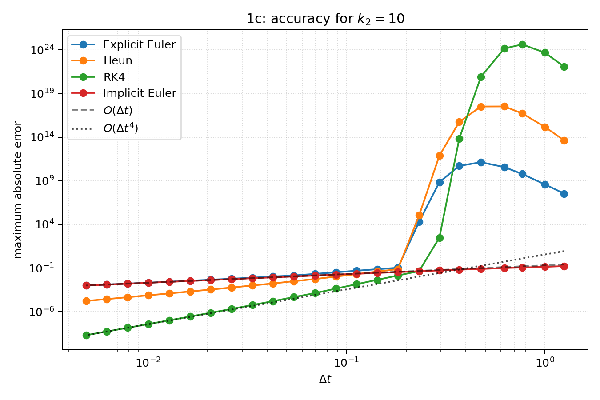
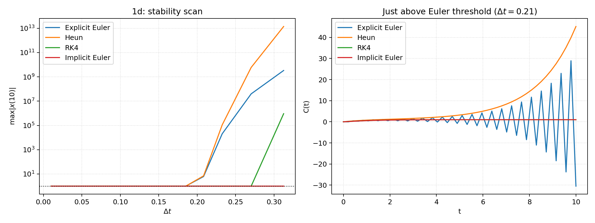
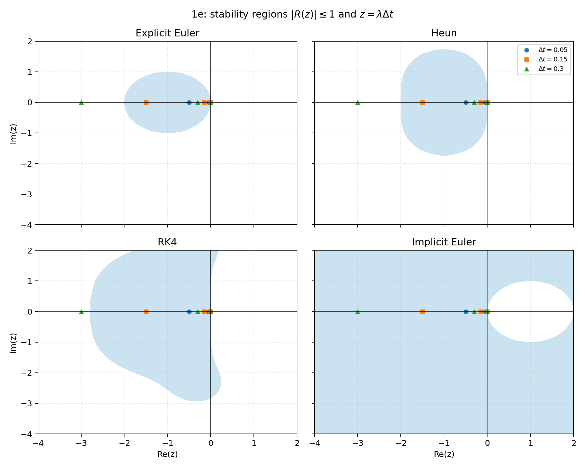
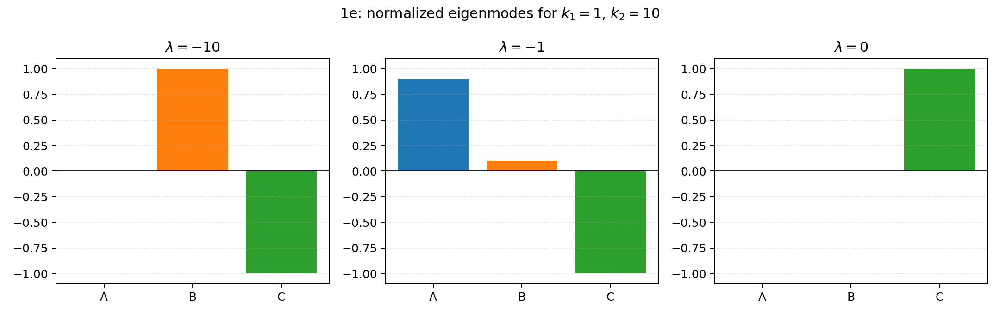
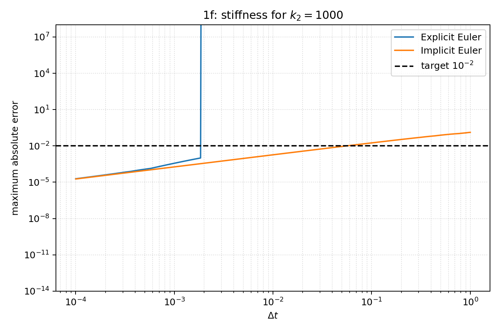

# Exercise 3 - Task 1: linear reaction chain

## 1a - Standard form and conservation law

With $x=(A,B,C)^T$, the reaction equations are

$$\dot x=Jx,\qquad J=\begin{pmatrix}-k_1&0&0\\k_1&-k_2&0\\0&k_2&0\end{pmatrix}.$$

The first row describes loss of A, the second the gain from A and loss to C, and the third the gain of C.
Adding the three equations gives $\dot A+\dot B+\dot C=0$. Therefore $A+B+C$ is constant and equals 1 for the given initial condition.

## 1b - Methods and correctness checks

The implementation is in [`exercise_03_ode.py`](../exercise_03_ode.py). It contains explicit Euler, Heun, classical RK4, and implicit Euler.
For implicit Euler the linear system $(I-\Delta t J)x_{n+1}=x_n$ is solved directly.
Correctness is checked against the analytical solution, by convergence slopes, and by the invariant $A+B+C=1$.
The exact solution used for comparison is

$$C(t)=1-\frac{k_2e^{-k_1t}-k_1e^{-k_2t}}{k_2-k_1},$$
$$C(t)=1-e^{-k_1t}(1+k_1t)\quad(k_1=k_2).$$

## 1c - Accuracy for $k_2=10$

The measured slopes on the finest eight step sizes are:

| Method | expected order | measured slope |
|---|---:|---:|
| Explicit Euler | 1 | 1.054 |
| Heun | 2 | 2.096 |
| RK4 | 4 | 4.103 |
| Implicit Euler | 1 | 0.995 |

Thus the log-log plot confirms first order for both Euler methods, second order for Heun, and fourth order for RK4 until round-off or stability effects dominate.

## 1d - Stability

For the negative real eigenvalue $-k_2$, the critical steps are approximately

| Method | critical $\Delta t$ for $k_2=10$ |
|---|---:|
| Explicit Euler | 0.2 |
| Heun | 0.2 |
| RK4 | 0.278529 |
| Implicit Euler | unconditional |

For explicit Euler and Heun the real-axis boundary is $\Delta t=2/k_{\max}$; for RK4 it is $\Delta t\approx2.7853/k_{\max}$. Here $k_{\max}=\max(k_1,k_2)$.
Just above the critical step, the fast mode changes from decaying to alternating and growing. The computed concentration therefore develops oscillations and eventually unphysical negative values.

## 1e - Eigenvalues, eigenvectors, and stability regions

The eigenvalues for $k_1=1$, $k_2=10$ are $-10$, $-1$, $0$; in general they are $0$, $-k_1$, and $-k_2$.
The eigenmode belonging to the most negative eigenvalue $-\max(k_1,k_2)$ becomes unstable first, because its $z=\lambda\Delta t$ reaches the left stability boundary first.
Implicit Euler has $R(z)=1/(1-z)$. For $\operatorname{Re}(z)\le0$, $|1-z|\ge1$, so $|R(z)|\le1$; it is therefore A-stable and always stable for this reaction problem.

## 1f - Stiffness, $k_2=1000$

The table uses the largest tested step with maximum error at most $10^{-2}$ over $t\in[0,10]$.

| Method | selected $\Delta t$ | steps | maximum error |
|---|---:|---:|---:|
| Explicit Euler | 0.00184434 | 5422 | 1.003e-03 |
| Implicit Euler | 0.0543478 | 184 | 9.785e-03 |

Explicit Euler is limited by stability: $\Delta t\le2/k_2=0.002$, so the fast transient forces thousands of steps even though the slow dynamics last until $t=10$.
Implicit Euler has no such stability restriction. Its step size is instead limited by accuracy, especially by resolving the fast initial transient and by the first-order truncation error.
