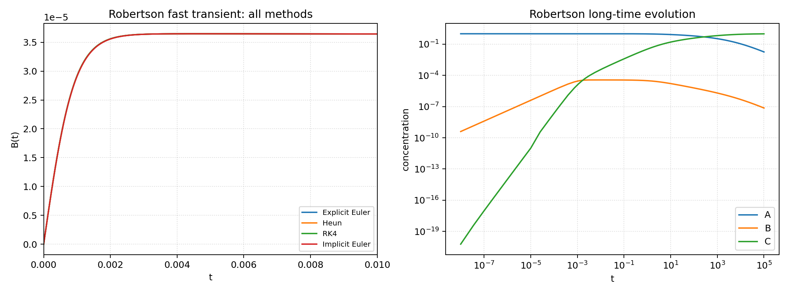
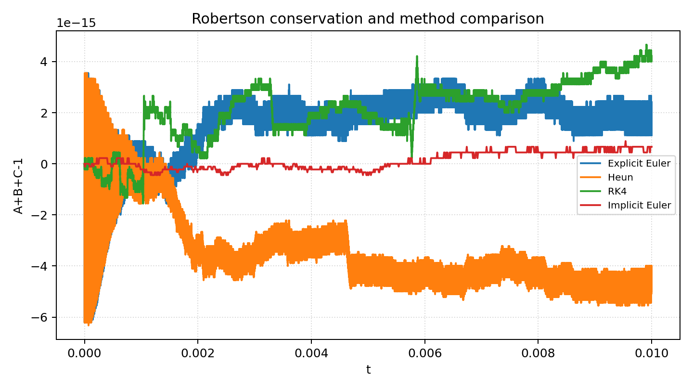
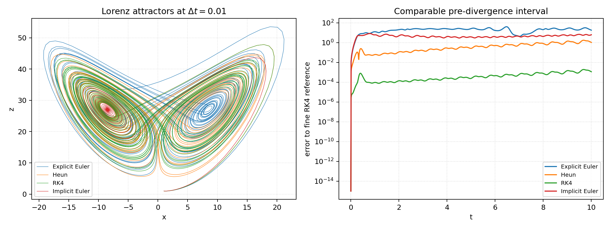
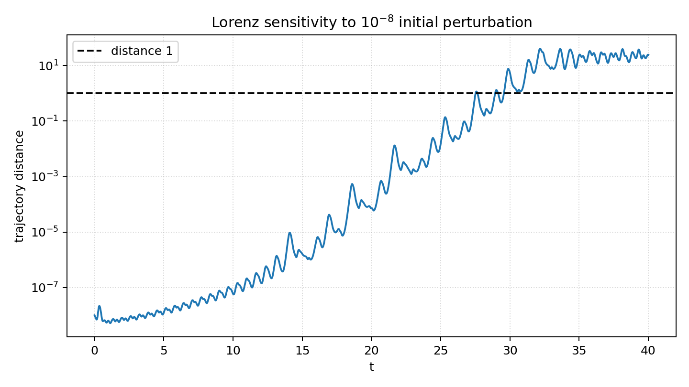

# Exercise 3 - Task 2: comparison of all methods

## Comparison strategy

I do not select a method in advance. All four methods from task 1 are tested:
explicit Euler, Heun, RK4, and implicit Euler. The comparison uses diagnostics
that match the two problems:

* **Robertson:** the fast transient is plotted on $[0,10^{-2}]$, while the
  complete evolution is plotted on logarithmic time over $[0,10^5]$. This is
  necessary because a single linear time axis would hide the initial chemistry.
  The full-interval implicit Euler result uses Newton's method and adaptive
  step doubling. The other methods are explicitly tested on the fast transient;
  their stability restriction is the relevant result.
* **Lorenz:** all methods use the same fixed $\Delta t=0.01$ and are compared
  against a fine RK4 reference only until $t=10$. The full $t=40$ attractors
  and the $10^{-8}$ perturbation are shown separately, because after chaotic
  separation pointwise error is no longer a useful criterion.

## 2a - Robertson model

The equations and parameters are

$$\dot A=-k_1A+k_3BC,\quad
\dot B=k_1A-k_2B^2-k_3BC,\quad
\dot C=k_2B^2,$$

with $k_1=0.04$, $k_2=3\cdot10^7$, $k_3=10^4$ and initial state $(1,0,0)$.

The transient comparison used the following steps:

| Method | $\Delta t$ | steps to $10^{-2}$ | minimum state | mass error |
|---|---:|---:|---:|---:|
| Explicit Euler | 1.0e-08 | 1000000 | 0.000e+00 | 6.217e-15 |
| Heun | 1.0e-08 | 1000000 | 0.000e+00 | 6.328e-15 |
| RK4 | 1.0e-07 | 100000 | 0.000e+00 | 4.663e-15 |
| Implicit Euler | 1.0e-05 | 1000 | 0.000e+00 | 8.882e-16 |

The long-time implicit run used 1904 accepted and
627 rejected steps, with 16200 Newton
iterations. Its final state is
$(A,B,C)=(0.01792,7.297e-08,0.9821)$.
The conserved mass is preserved to
1.998e-15.

**Interpretation.** Robertson is a stiff problem. Explicit Euler, Heun and RK4
can be made to work only with steps resolving the fastest mode, which makes the
cost over $[0,10^5]$ impractical. Heun and RK4 are more accurate per stable
step than Euler, but their explicit stability regions still impose a very small
step. Implicit Euler is only first order, but it remains stable for large steps
and is therefore the practical method for the full interval. Newton's method is
required because the implicit equation is nonlinear. The method is trusted
because Newton residuals, positivity, mass conservation, and tolerance
refinement are all checked.

## 2b - Lorenz system

The parameters are $\sigma=10$, $\rho=28$, $\beta=8/3$ and the two initial
states are $(1,1,1)$ and $(1,1,1+10^{-8})$.

Maximum errors against fine RK4 on $0\le t\le10$ at the common step
$\Delta t=0.01$ are:

| Method | maximum pre-divergence comparison error |
|---|---:|
| Explicit Euler | 4.007e+01 |
| Heun | 1.726e+00 |
| RK4 | 1.919e-03 |
| Implicit Euler | 8.208e+00 |

The two RK4 trajectories with the perturbed initial state first differ by one
at approximately
$27.520$.
For Lorenz, RK4 is the most accurate of these four methods at equal step size;
Heun is next, followed by the two first-order Euler methods. Implicit Euler is
not preferred here: it is stable, but its numerical damping distorts the
chaotic dynamics. The appropriate checks without an exact solution are step
refinement before separation, bounded attractor geometry, and the expected
exponential growth of the perturbation.
